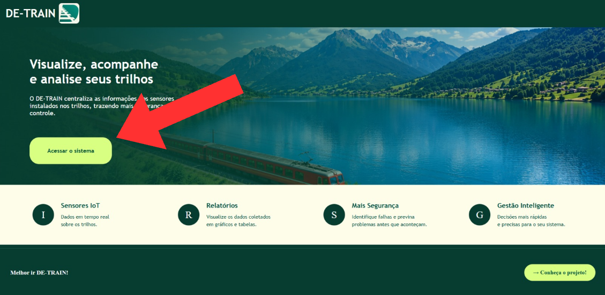

# DE-TRAIN
## Guia do Usuário

**Versão:** 2.0

**Integrantes:** Leonardo Aguiar, Miguel Kormann, Theo Maccari e Tiago Cabral.

---

# Índice

1. [Introdução](#introdução)
2. [Instruções de uso](#instruções-de-uso)
3. [Dicas e boas práticas](#dicas-e-boas-práticas)
4. [Solução de problemas (FAQ)](#solução-de-problemas-faq)
5. [Suporte e contatos](#suporte-e-contatos)

---

# Introdução

## 1. Sobre o sistema

O DE-TRAIN é um sistema que permite visualizar informações sobre trens coletadas por sensores instalados nos trilhos ferroviários.

O sistema centraliza essas informações, proporcionando maior segurança, eficiência e controle na operação ferroviária.

## 2. Objetivo do manual

Este manual tem como objetivo orientar os usuários finais sobre a utilização do site DE-TRAIN, apresentando suas principais funcionalidades e os procedimentos necessários para utilizá-las.

---

# Instruções de uso

## 1. Para entrar em sua conta

Clique em **"Acessar Sistema"**, localizado no centro da tela inicial. Ao clicar, você será redirecionado para a página de login, onde deverá informar seu e-mail e senha para acessar o sistema.

## 2. Para cadastrar um item

Na página inicial do sistema, no menu localizado à esquerda, estarão disponíveis as opções de cadastro. Ao selecionar uma delas, uma janela será aberta na tela, permitindo realizar o cadastro do item desejado.

## 3. Para visualizar as tabelas

Na página inicial, no menu à esquerda, estará disponível a seção **"Acessos rápidos"**, utilizada para acessar as tabelas e visualizar os registros dos itens cadastrados.

## 4. Para acessar a landing page

Na página inicial, haverá um botão escrito **"Conheça o projeto!"**, localizado no canto inferior direito. Ao clicar nele, você será redirecionado para a landing page, onde poderá conhecer mais sobre o projeto.

## 5. Para realizar logout

Para realizar o logout e sair da sua conta, clique em **"Sair"**, localizado no canto superior direito da página, ao lado das informações do usuário.

---

# Dicas e boas práticas

## 1. Cuidados no manuseio

- Utilize o sistema por meio de um navegador atualizado e compatível.
- Não feche a página ou o navegador durante operações importantes, como cadastros ou alterações de informações.
- Caso ocorra algum erro ou comportamento inesperado, não repita diversas vezes a mesma operação. Verifique os dados inseridos e, se o problema persistir, comunique o responsável pelo sistema.
- O DE-TRAIN está sujeito a futuras atualizações e melhorias, podendo receber novas funcionalidades e correções conforme as necessidades identificadas.

## 2. Recomendações para uso seguro

- Não compartilhe dados de acesso, como usuário e senha, com outras pessoas.
- Durante a utilização do sistema, recomenda-se manter uma conexão estável com a internet e evitar interromper o acesso durante operações de cadastro ou atualização de dados.

---

# Solução de problemas (FAQ)

## 1. O que é o DE-TRAIN?

O DE-TRAIN é um sistema desenvolvido para centralizar e apresentar informações relacionadas ao monitoramento ferroviário, utilizando dados coletados por sensores instalados nos trilhos.

## 2. Quem pode utilizar o DE-TRAIN?

O sistema pode ser utilizado por dois tipos de usuários: funcionário e gerente, de acordo com suas permissões de acesso. Cada tipo de conta possui acesso às funcionalidades correspondentes ao seu nível de autorização.

## 3. O que fazer se ocorrer um erro durante o uso do sistema?

Verifique se os dados inseridos estão corretos e tente realizar a operação novamente. Se o erro persistir, entre em contato com o responsável pelo sistema e informe o procedimento realizado e a mensagem de erro apresentada.

## 4. O sistema pode ter alterações futuras ou indisponibilidades?

Sim. O DE-TRAIN está sujeito a futuras atualizações e melhorias, podendo receber novas funcionalidades e correções conforme as necessidades identificadas.

## 5. Quais são as diferenças entre funcionário e gerente?

O gerente possui acesso ao gerenciamento de usuários, podendo cadastrar, editar e excluir contas de funcionários. Já o funcionário possui acesso às funcionalidades operacionais do sistema, como o gerenciamento de trens, rotas e sensores.

---

# Suporte e contatos

Em caso de dúvidas, dificuldades ou problemas durante a utilização do sistema, entre em contato com um dos integrantes responsáveis pelo projeto:

1. miguel_peters@estudante.sesisenai.org.br
2. leonardo_n_aguiar@estudante.sesisenai.org.br
3. tiago_cs_ferreira@estudante.sesisenai.org.br
4. theo_maccari@estudante.sesisenai.org.br

---

**DE-TRAIN — SA-Ferrorama**  
*Manual do Usuário — Versão 2.0*